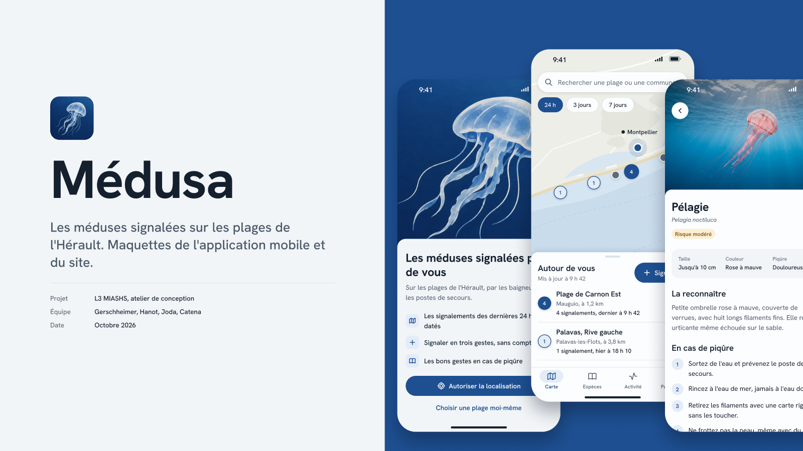
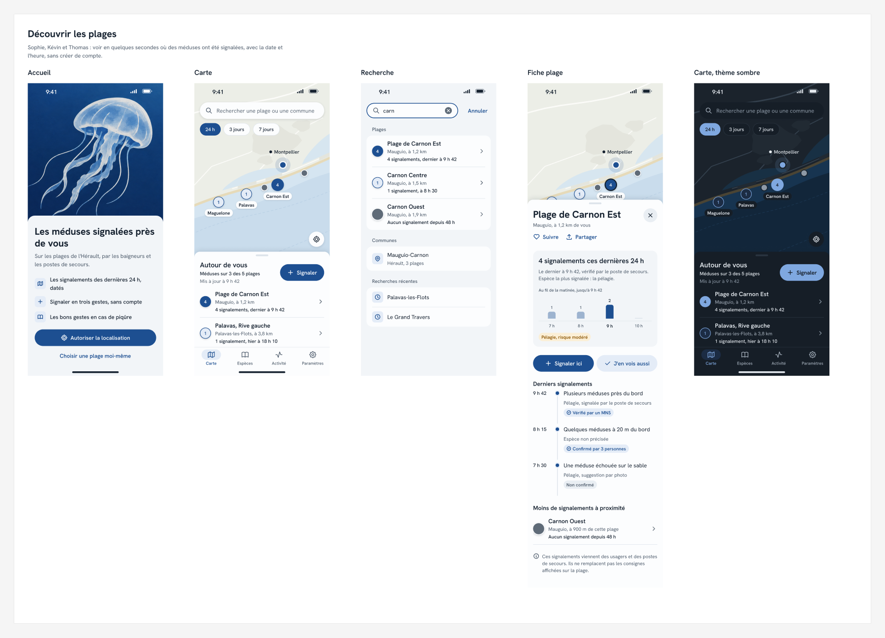
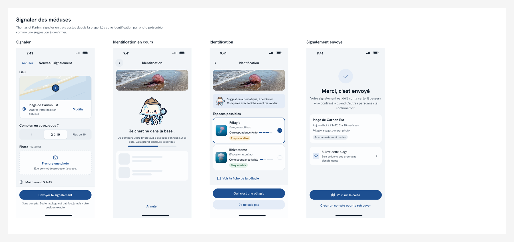
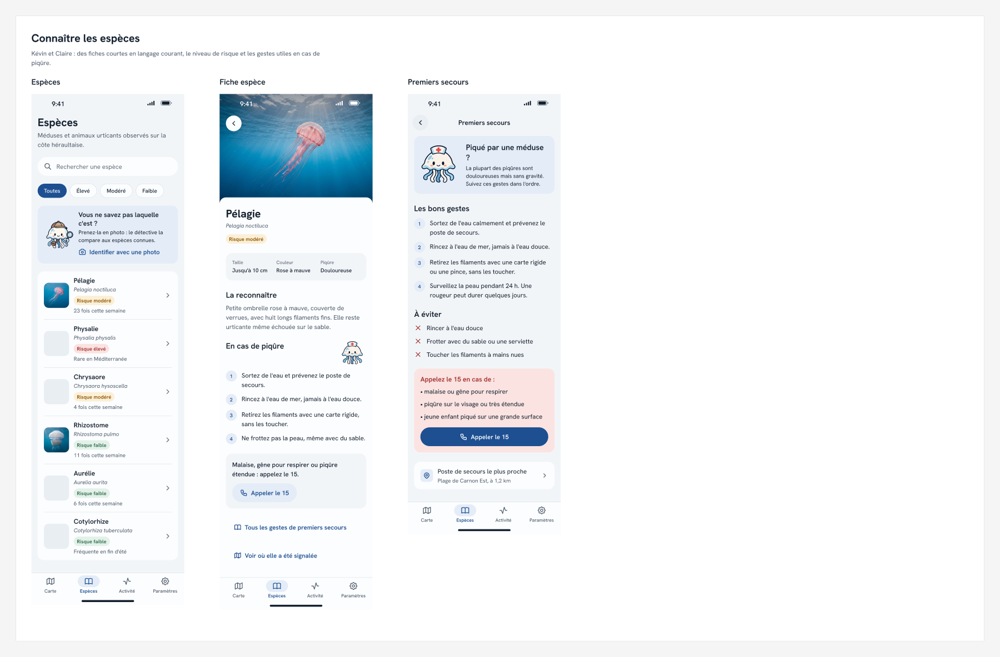
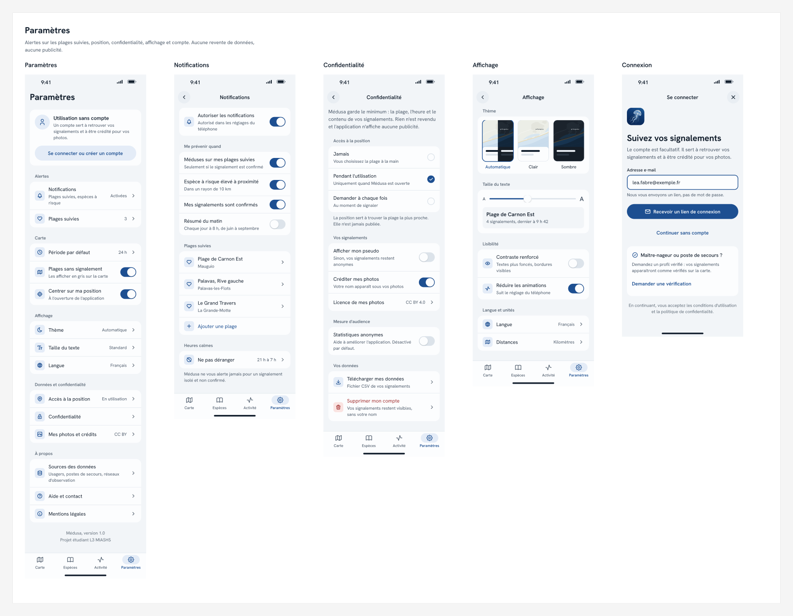
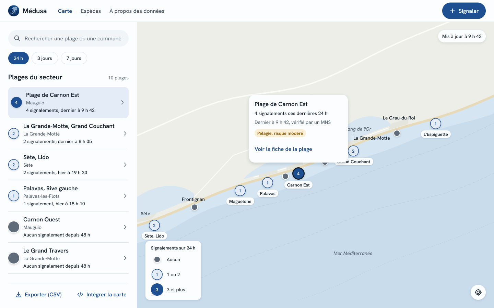

# Medusa
A public website where you can visualize data about jellyfish activity

## Maquette (en cours)

Captures de la maquette Figma au 16 octobre 2026.

- [Ouvrir la maquette Figma](https://www.figma.com/design/lFiWF49YxBC2q47mbJY09i/M%C3%A9dusa?node-id=31-569)
- [Lancer le prototype cliquable](https://www.figma.com/proto/lFiWF49YxBC2q47mbJY09i/M%C3%A9dusa?node-id=38-1668&starting-point-node-id=38%3A1668)

### Découvrir les plages

### Signaler des méduses

### Connaître les espèces

### Paramètres

### Version ordinateur

